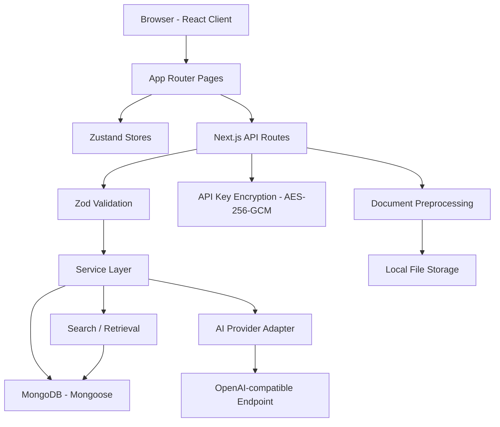
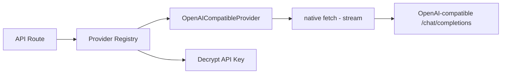

# GATE 2027 AI — Architecture & Implementation Plan

## 1. Summary

A production-quality, single-user (local) web application that acts as a personalized
GATE 2027 CSE research and learning companion. The UX is modeled on ChatGPT/DeepSeek,
but every layer is purpose-built for GATE preparation.

### Confirmed decisions
- **Stack**: Next.js (App Router) + TypeScript + Tailwind CSS + shadcn/ui + Lucide
- **Database**: MongoDB via Mongoose (no RLS needed for single-user; schema reserves `userId` for v2 multi-user)
- **Auth**: Skipped in v1 (single-user local app). Reserved in schema.
- **Package manager**: pnpm
- **AI integration**: Native `fetch`-based OpenAI-compatible adapter (no OpenAI SDK)
- **State**: Zustand
- **Markdown/LaTeX/Code**: react-markdown + remark-gfm + remark-math + rehype-katex + rehype-pretty-code (Shiki)

---

## 2. High-Level Architecture



### Key principles
- **Server-only AI calls**: API keys never reach the browser. Chat, embeddings, and
  provider config all live server-side.
- **Provider abstraction**: a single `AiProvider` interface with an
  OpenAI-compatible implementation, selected via a registry. Adding another provider
  requires only a new adapter file, not application changes.
- **Context management**: active context = recent messages + rolling summary + flagged
  important extracts; never blindly send full history.
- **No fabricated data**: PYQ workspace and syllabus seed only contain verified/manually
  entered data.

---

## 3. Directory Structure

```
GATE_APP/
├── app/
│   ├── layout.tsx                  # root layout, providers, theme
│   ├── page.tsx                    # redirect to /chat
│   ├── globals.css
│   ├── (app)/
│   │   ├── layout.tsx              # app shell: sidebar + main
│   │   ├── chat/
│   │   │   ├── page.tsx            # welcome / new chat
│   │   │   └── [id]/page.tsx       # conversation view
│   │   ├── dashboard/page.tsx
│   │   ├── notes/page.tsx
│   │   ├── pyq/page.tsx
│   │   ├── subjects/page.tsx
│   │   └── settings/page.tsx
│   └── api/
│       ├── chat/route.ts
│       ├── conversations/route.ts
│       ├── conversations/[id]/route.ts
│       ├── messages/route.ts
│       ├── notes/route.ts
│       ├── notes/[id]/route.ts
│       ├── documents/route.ts
│       ├── documents/[id]/route.ts
│       ├── pyqs/route.ts
│       ├── pyqs/[id]/route.ts
│       ├── pyqs/attempts/route.ts
│       ├── subjects/route.ts
│       ├── topics/route.ts
│       ├── progress/route.ts
│       ├── providers/route.ts
│       ├── profiles/route.ts
│       ├── preferences/route.ts
│       ├── search/route.ts
│       └── health/route.ts
├── components/
│   ├── ui/                         # shadcn/ui primitives
│   ├── layout/                     # sidebar, header, mobile drawer
│   ├── chat/                       # message list, composer, actions
│   ├── markdown/                   # MarkdownRenderer, CodeBlock, Math
│   ├── subjects/                   # subject + topic pickers
│   ├── dashboard/                  # progress components
│   ├── notes/                      # note editor + cards
│   ├── pyq/                        # PYQ list + attempt flow
│   └── settings/                   # settings forms
├── lib/
│   ├── db/
│   │   ├── client.ts               # mongoose singleton
│   │   └── models/                 # all models
│   ├── ai/
│   │   ├── provider.ts             # interface + types
│   │   ├── openai-compatible.ts    # fetch implementation
│   │   ├── registry.ts             # provider factory
│   │   ├── system-prompts.ts       # default mentor prompt
│   │   ├── context.ts              # context builder + summarizer
│   │   └── stream.ts               # streaming helpers
│   ├── crypto.ts                   # AES-256-GCM API key encryption
│   ├── documents/                  # preprocessing pipeline
│   ├── search/                     # keyword + optional embeddings
│   ├── validation/                 # zod schemas
│   ├── utils.ts
│   └── constants.ts
├── store/                          # zustand stores
├── seed/
│   ├── subjects.ts                 # GATE 2027 CSE syllabus seed
│   ├── profiles.ts                 # default AI behavior profiles
│   └── index.ts
├── storage/                        # uploaded files (gitignored)
├── types/                          # shared TS types
├── plans/
├── .env.example
├── .gitignore
├── next.config.ts
├── tailwind.config.ts
├── tsconfig.json
└── package.json
```

---

## 4. Data Model (MongoDB Collections)

All documents include `userId` (optional) to future-proof v2 multi-user.

### subjects
- `slug` (unique), `name`, `code`, `color`, `description`, `order`

### topics
- `subjectId` (ref, indexed), `name`, `slug`, `order`
- Unique index on `(subjectId, slug)`

### conversations
- `title`, `subjectId?`, `topicId?`, `isPinned`, `isArchived`,
  `summary`, `importantExcerpts`, `messageCount`, `lastMessageAt`,
  `createdAt`, `updatedAt`

### messages
- `conversationId` (ref, indexed), `role` (`user` | `assistant`),
  `content`, `summary?`, `isImportant`, `tokenCount`, `createdAt`
- _v1: no attachments (document uploads deferred to v2)._

### notes (personal knowledge base)
- `title`, `content` (markdown), `subjectId?`, `topicId?`, `tags[]`,
  `importance`, `isFavorite`, `sourceMessageId?`, `createdAt`, `updatedAt`

### documents (uploads) — **v2, not in v1**
- Deferred per product decision on 2026-11-21. Removed from v1 entirely: no
  `Document` model, no upload route, no `pdf-parse`. Planned shape for v2:
  `filename`, `mimeType`, `size`, `storagePath`, `extractedText`, `summary?`,
  `subjectId?`, `status` (`processing` | `ready` | `failed`), `error?`, `createdAt`

### aiproviders
- `name`, `baseUrl`, `apiKeyEncrypted`, `model`, `temperature`,
  `maxTokens`, `isActive`, `createdAt`, `updatedAt`

### aiprofiles (behavior profiles)
- `name`, `slug`, `description`, `systemPrompt`, `temperature`, `isDefault`

### preferences (singleton)
- `theme`, `defaultSubjectId?`, `defaultProfileId?`, `customSystemPrompt?`,
  `responseStyle`, `streamingEnabled`, `contextWindow`

### progress
- `subjectId?`, `topicId?`, `status`
  (`not-started` | `in-progress` | `completed` | `to-revise`),
  `note?`, `updatedAt`

### studySessions (streak/activity)
- `date`, `subjectId?`, `durationMinutes`

### pyqs (manually entered / imported, always verified)
- `subjectId?`, `topicId?`, `year`, `question` (markdown),
  `options[]` (`text`, `isCorrect`), `explanation`, `source`,
  `isVerified`, `difficulty`, `isBookmarked`, `createdAt`

### pyqAttempts
- `pyqId` (ref), `selectedOption`, `isCorrect`, `attemptedAt`

---

## 5. AI Provider Adapter

The chat feature is built specifically around **OpenAI-compatible API keys**. Any
service that implements the OpenAI `/chat/completions` wire protocol (OpenAI,
DeepSeek, OpenRouter, Groq, Together, local OpenAI-compatible servers such as
Ollama/LM Studio, etc.) works by changing only the base URL, key, and model name —
no code changes.



### Request shape (per provider config)

```text
POST {baseUrl}/chat/completions
Authorization: Bearer {decrypted API key}
Content-Type: application/json
{
  "model": "{model}",
  "messages": [{ role, content }, ...],
  "stream": true,
  "temperature": {temperature},
  "max_tokens": {maxTokens}
}
```

### Streaming response handling

```text
OpenAI-compatible SSE stream lines:
  data: {"choices":[{"delta":{"content":"..."}}]}
  data: [DONE]
```

- Each `data:` line is parsed; `delta.content` chunks are forwarded to the browser
  as a streaming `ReadableStream` (text/event-stream).
- `[DONE]` terminates the stream.
- Non-2xx responses and mid-stream `error` payloads are mapped to a standardized
  error envelope.

### Configurable per provider (stored in `aiproviders`)
- `baseUrl`, `apiKey` (encrypted), `model`, `temperature`, `maxTokens`,
  `isActive`.

### Interface
- `AiProvider` interface: `chatStream(messages, options)` returning a `ReadableStream`,
  plus `chat` (non-stream) and optional `embeddings`.
- `OpenAICompatibleProvider` is the default implementation; the registry selects it
  from the active provider config.
- Timeouts via `AbortController`; rate-limit (429) handled with `Retry-After`.
- Standardized error envelope mapped to HTTP responses.

### Security
- API keys encrypted at rest with AES-256-GCM using `ENCRYPTION_KEY` from env.
- Keys stored server-side only; never returned to client (masked).
- `.env*` gitignored; secrets never logged.

---

## 6. Context Management Strategy

1. **Active context**: last N messages (configurable) sent on every request.
2. **Rolling summary**: older messages summarized and stored on the conversation;
   summary replaces them in the active context.
3. **Important excerpts**: messages flagged as important are always retained.
4. **Retrieval (RAG)**: v1 searches over **notes + messages** (keyword). Vector
   search and document-text retrieval are deferred to v2.

---

## 7. Document Preprocessing Pipeline — **v2, not in v1**

Deferred on 2026-11-21 (v1 is chat-only). Planned for v2:

- **PDF**: text extraction via `pdf-parse`.
- **Text/Markdown/Code**: read as UTF-8 text.
- **Images**: stored and optionally passed to a vision-capable model; OCR optional
  (tesseract.js).
- Enforced limits: max file size, allow-listed MIME types, per-document validation.

---

## 8. Design Language

- Neutral palette with restrained blue accent; light/dark/system theme.
- Clean typography, generous spacing, subtle borders, rounded components.
- Minimal decorative elements; no glassmorphism or excessive gradients.
- Fully responsive: desktop sidebar, tablet, mobile drawer.

---

## 9. GATE Syllabus Seed

The 12 subjects below are seeded as **configurable data** (not hardcoded in UI).
Topics are seeded from the official GATE CSE syllabus and remain expandable.

1. Engineering Mathematics
2. Discrete Mathematics
3. Digital Logic
4. Computer Organization and Architecture
5. Programming and Data Structures
6. Algorithms
7. Theory of Computation
8. Compiler Design
9. Operating Systems
10. Databases
11. Computer Networks
12. General Aptitude

---

## 10. Phased Implementation Plan

1. **Phase 1 — Inspection & Architecture** (this phase)
2. **Phase 2 — Core Chat Application**: layout, sidebar, composer, streaming,
   Markdown/LaTeX/code rendering, conversation persistence.
3. **Phase 3 — AI Integration**: provider abstraction, config, key management,
   streaming + error handling.
4. **Phase 4 — GATE Personalization**: subjects/topics, behavior profiles, system prompt.
5. **Phase 5 — Knowledge Management**: notes, saved messages, search, uploads.
6. **Phase 6 — Dashboard & PYQ Workspace**: progress, dashboards, PYQs, mistake notebook.
7. **Phase 7 — Testing & Refinement**: feature testing, build, security, responsiveness.

---

## 11. Environment Variables (.env.example)

- `MONGODB_URI`
- `ENCRYPTION_KEY` (32-byte hex for AES-256-GCM)
- Optional AI defaults (overridable in Settings): `AI_BASE_URL`, `AI_API_KEY`,
  `AI_MODEL`, `AI_TEMPERATURE`, `AI_MAX_TOKENS`

---

## 12. Out of Scope for v1 (documented)

- Multi-user authentication (v2).
- Vector search requiring a separate embedding service (keyword search works by default).
- Optional OCR for images (vision-model path used first).
